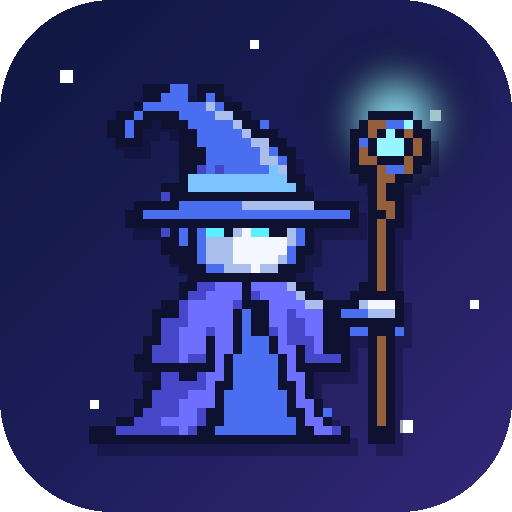
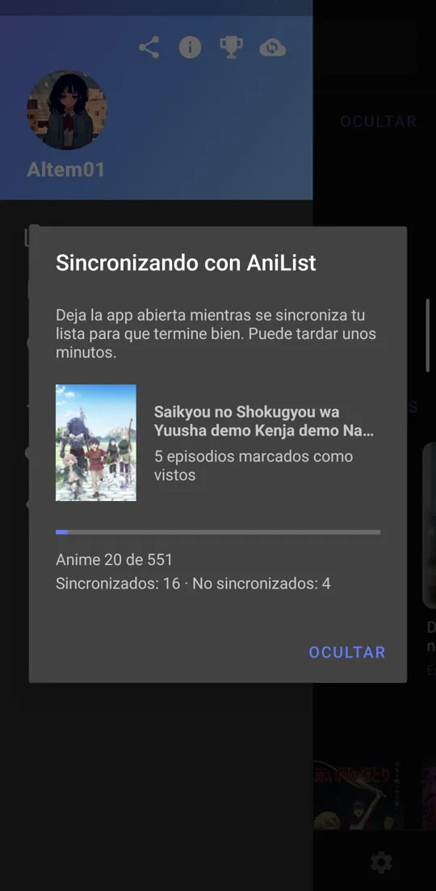
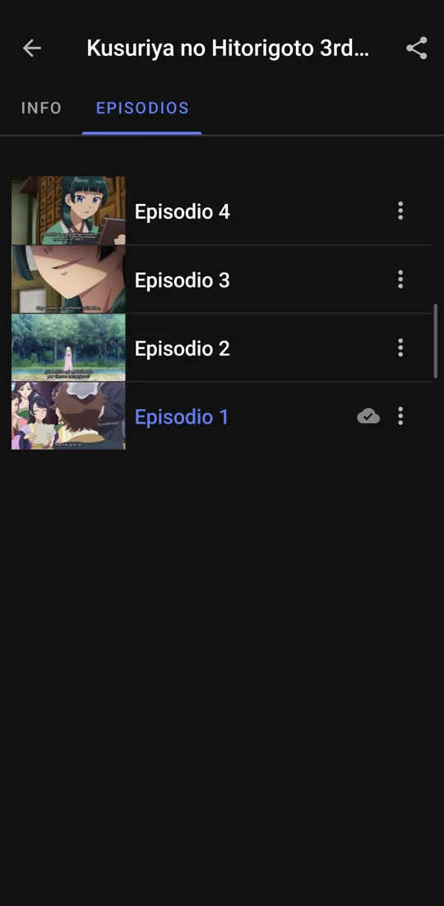
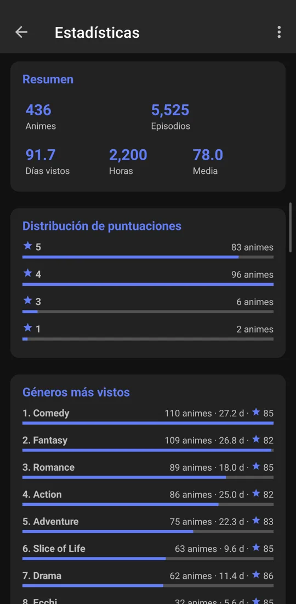
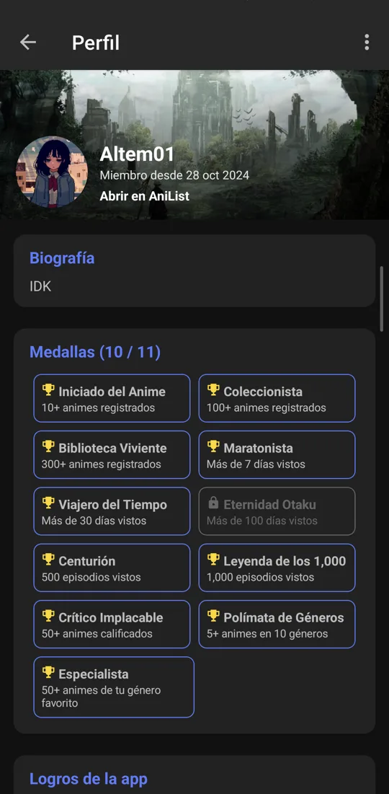

<p align="center"></p>

# UkiList

[](LICENSE)
[](https://github.com/jordyamc/UKIKU)
[-3DDC84?logo=android&logoColor=white)](https://developer.android.com)
[](https://github.com/Altem1/UkiList/releases)

**UkiList** (`com.altem1.ukilist`) es un fork no oficial de [UKIKU](https://github.com/jordyamc/UKIKU) que conecta la app con tu cuenta de [AniList](https://anilist.co): importa tu biblioteca, marca lo que ya viste y registra cada episodio que terminas, sin que tengas que hacer nada.

**Sitio web y descarga:** https://altem1.github.io/UkiList/

<p align="center">
  
  
  
  
</p>

---

## Funciones

### Sincronización con AniList
- **Conexión con AniList (OAuth2)** desde el menú lateral o en Ajustes > Sincronización. El token se guarda cifrado (`EncryptedSharedPreferences`) y el inicio de sesión valida `state` contra CSRF.
- **Importar biblioteca (AniList → app)**: trae tus listas y marca los episodios vistos. La primera sincronización muestra una ventana con la carátula del anime en curso, la barra de avance y el contador de sincronizados y no sincronizados. Se repite sola cada 12 horas.
- **Scrobble automático (app → AniList)**: al ver el 85 % de un episodio o terminarlo, se registra en AniList con `WorkManager`, aunque cierres el reproductor de golpe.
- **Rewatch**: si vuelves a ver un anime completado, AniList lo marca como *Rewatching*; al terminarlo vuelve a *Completado* y suma la repetición.
- **Vistos desde AniList**: al abrir un anime se marcan como vistos los episodios que ya tienes en tu progreso de AniList.
- **Marcar y desmarcar a mano**: marcar un episodio lo sube; desmarcarlo baja el progreso en AniList al mayor episodio visto que quede.
- **Estados de la lista**: Viendo, Considerando, Completado, Abandonado y Pausado se suben a AniList, con aviso al confirmarse.
- **Nube por episodio**: indica si cada episodio ya está en AniList o sigue pendiente.
- **Excepciones de AniList**: lo que no se pudo subir aparece en el menú lateral, con el motivo. Puedes reintentar todo, reintentar uno o elegir a mano el anime correcto.
- **Emparejamiento por título**: busca el anime por rōmaji, inglés y sinónimos, y tolera variantes como "Season 2", "2nd Season" o "II". Guarda el resultado para no repetir búsquedas.

### Sección AniList
- **Mi lista**: historial, viendo, pendientes, completados y demás listas de AniList, con progreso y puntuación. Desde ahí abres el anime en la app o en AniList.
- **Estadísticas**: animes, episodios, días y horas vistos, media, distribución de puntuaciones, géneros, años, formatos y estados.
- **Perfil**: avatar, portada, biografía, medallas por lo que has visto, logros de la app y favoritos de anime, personajes, staff y estudios.
- **Menú lateral**: muestra tu avatar, tu nombre y la portada de tu perfil de AniList.

### Reproductor
- **Autoplay estilo Netflix**: al terminar un episodio, el actual se encoge y aparece el siguiente con cuenta regresiva. Usa el mismo servidor y, si no tiene el episodio, prueba con los demás. Funciona en el reproductor básico y en el avanzado.

### Además
- Todo lo de UKIKU: recientes, emisión, catálogo, explorador, descargas, cola, historial, sugerencias, logros y temas.
- Logo propio (mago en pixel art) y color azul-morado por defecto.
- Se quitaron Noticias y FAQ del menú.
- Identificador propio (`com.altem1.ukilist`): se instala junto a UKIKU sin conflicto.

---

## Novedades técnicas respecto a UKIKU

- Se quitaron las integraciones de anuncios y Dropbox del proyecto original.
- Módulo `:dtpv` ([DoubleTapPlayerView](https://github.com/vkay94/DoubleTapPlayerView)) integrado localmente y portado a **AndroidX Media3**.
- Valores de Firebase Remote Config servidos localmente, sin depender del backend original.
- Room con migraciones para el mapeo de AniList (`anilist_mapping`) y el estado de sync por episodio (`anilist_scrobble`).

---

## Compilación

1. Clona este repositorio:
   ```bash
   git clone https://github.com/Altem1/UkiList.git
   cd UkiList
   ```
2. Crea un cliente de API en [AniList Developer Settings](https://anilist.co/settings/developer) con el **Redirect URL**:
   ```
   ukiku://anilist-callback
   ```
3. En la raíz del proyecto, asegúrate de definir tu `ANILIST_CLIENT_ID` en `local.properties`:
   ```properties
   ANILIST_CLIENT_ID=tu_client_id
   ```
4. Compila el APK con Gradle (requiere JDK 17):
   ```bash
   ./gradlew assembleDebug
   ```

---

## Créditos y agradecimientos

Este proyecto existe gracias al trabajo de código abierto de sus autores originales:

- **[UKIKU](https://github.com/jordyamc/UKIKU)** — Proyecto original creado y desarrollado por **Jordy Alexis Mendoza Caballero** ([@jordyamc](https://github.com/jordyamc)).
- **[DoubleTapPlayerView](https://github.com/vkay94/DoubleTapPlayerView)** — Librería de gestos de doble toque creada por **Viktor Krez** ([@vkay94](https://github.com/vkay94)), incluida en este repositorio bajo el módulo `:dtpv` (portada a Media3).
- **[AniList](https://anilist.co)** — Sincronización y metadatos de seguimiento proporcionados a través de la [API pública GraphQL de AniList](https://github.com/AniList/ApiV2-GraphQL-Docs).
- **Fork (`UkiList`)** — Mantenido por **Altem01** ([@Altem1](https://github.com/Altem1)).

---

## Licencia

Este proyecto se distribuye bajo la **Licencia MIT**, conservando íntegros los derechos de autor y avisos de licencia del proyecto original [UKIKU](https://github.com/jordyamc/UKIKU) ([`LICENSE`](LICENSE)):

```text
MIT License

Copyright (c) 2018 Jordy Alexis Mendoza Caballero

Permission is hereby granted, free of charge, to any person obtaining a copy
of this software and associated documentation files (the "Software"), to deal
in the Software without restriction, including without limitation the rights
to use, copy, modify, merge, publish, distribute, sublicense, and/or sell
copies of the Software, and to permit persons to whom the Software is
furnished to do so, subject to the following conditions:

The above copyright notice and this permission notice shall be included in all
copies or substantial portions of the Software.

THE SOFTWARE IS PROVIDED "AS IS", WITHOUT WARRANTY OF ANY KIND, EXPRESS OR
IMPLIED, INCLUDING BUT NOT LIMITED TO THE WARRANTIES OF MERCHANTABILITY,
FITNESS FOR A PARTICULAR PURPOSE AND NONINFRINGEMENT. IN NO EVENT SHALL THE
AUTHORS OR COPYRIGHT HOLDERS BE LIABLE FOR ANY CLAIM, DAMAGES OR OTHER
LIABILITY, WHETHER IN AN ACTION OF CONTRACT, TORT OR OTHERWISE, ARISING FROM,
OUT OF OR IN CONNECTION WITH THE SOFTWARE OR THE USE OR OTHER DEALINGS IN THE
SOFTWARE.
```
